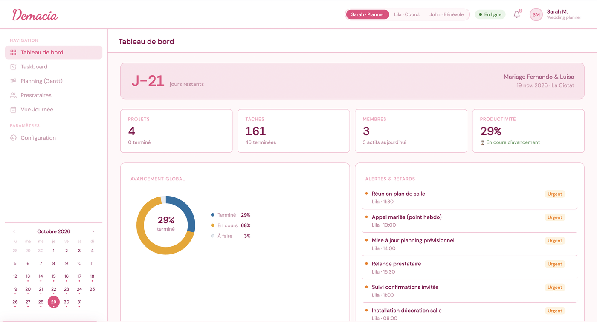
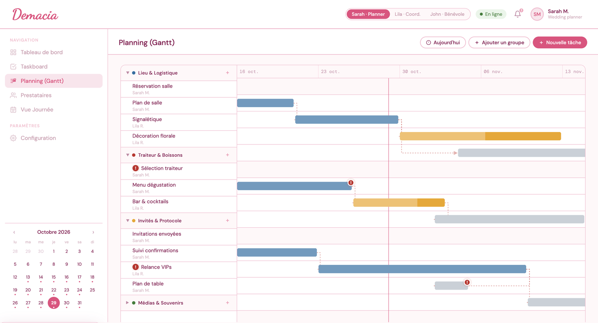
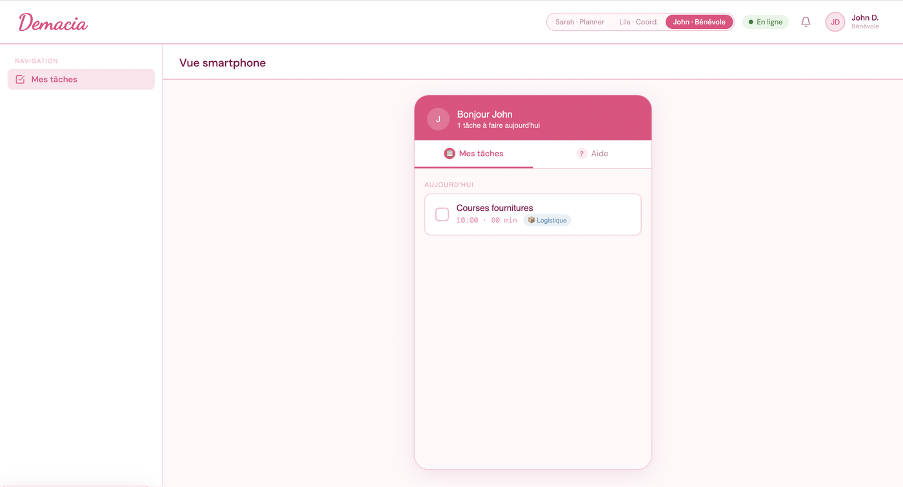

<p align="center">
  
</p>

# DEMACIA

Application web de coordination pour wedding planners.

Projet réalisé dans le cadre de l'UE Interaction Homme-Machine du Master ICO à l'Université de Montpellier (2025-2026), encadré par Mountaz Hascoët.

**👉 [Essayer l'application en ligne](https://chirinee.github.io/Demacia/)** — rien à installer, il suffit de basculer entre les rôles Sarah, Lila et John en haut de l'écran.

<p align="center">
  
</p>

<p align="center">
  
  
</p>
<p align="center"><em>Tableau de bord de Sarah, planning Gantt avec dépendances, et vue smartphone de John.</em></p>

## Équipe

- Nassera Nabgaoui
- Chirine El Aidouni
- Tanteliniaina-Erica Rabenaarivo

## De quoi il s'agit ?

DEMACIA est une application destinée aux équipes de wedding planning pour coordonner la préparation et le déroulement d'un mariage. Elle s'adresse à trois types d'utilisateurs qui collaborent ensemble : la wedding planner qui supervise, son assistante de coordination, et les bénévoles présents le jour J. Chacun a une vue adaptée à son rôle et à son appareil.

Le scénario de démo embarqué dans l'app est le mariage fictif de Fernando et Luisa à La Ciotat, mais l'app est pensée pour être utilisée sur n'importe quel mariage : il suffit de modifier la configuration (nom des mariés, date, lieu) dans les paramètres.

Pour que la démo reste parlante quel que soit le jour où on l'ouvre, toutes les dates du scénario sont calculées par rapport à la date du jour : le mariage a toujours lieu trois semaines plus tard (réglable via `DEMO_DAYS_BEFORE_WEDDING` dans `script.js`).

## Les trois profils

Sarah, la wedding planner, travaille sur ordinateur. Elle a accès à tout : le tableau de bord avec les KPI globaux, le taskboard kanban, le planning Gantt, la gestion des prestataires, la vue journée et la configuration générale.

Lila, son assistante, travaille sur tablette le jour du mariage. Elle voit le taskboard, ses propres todos, les tâches qu'elle a assignées à John, les prestataires et la vue journée. Elle peut tout modifier sauf les paramètres.

John, bénévole, est sur smartphone. Il ne voit qu'une chose : ses propres tâches du jour, dans une interface mobile simplifiée. Il peut les cocher au fur et à mesure qu'il les accomplit, même hors-ligne.

Les permissions sont strictes : John ne peut pas accéder à la vue journée ni voir les tâches des autres, et Lila n'a pas accès au dashboard ni au Gantt.

## Les vues principales

Le **dashboard** (Sarah) affiche un compte à rebours jusqu'au jour J, des KPI dynamiques (tâches terminées, productivité, membres actifs), un donut d'avancement et la liste des alertes en cours.

Le **taskboard** est un kanban classique avec quatre colonnes (À faire, En cours, Revue, Achevé). On peut glisser-déposer les cartes, filtrer, ajouter des groupes, renommer ou supprimer une colonne via son menu.

Le **planning Gantt** montre toutes les tâches sur une frise temporelle, regroupées par catégorie. Les dépendances entre tâches sont représentées par des flèches en pointillés. Les tâches urgentes ont un point rouge pulsant.

La **gestion des prestataires** utilise un système de feux tricolores : arrivé (vert), en cours (orange), en retard (rouge). Sarah peut ajouter un prestataire et tout le monde peut faire évoluer leur statut au fur et à mesure de la journée.

La **vue journée** affiche une grille horaire de 6h à 23h. Les tâches s'affichent comme des blocs colorés selon leur catégorie, dont on peut ajuster la durée en tirant la poignée du bas (avec un snap toutes les 15 minutes). On peut aussi les déplacer en les glissant.

La **vue todos de Lila** a deux onglets : ses propres tâches et celles qu'elle a assignées à John. Elle peut créer une nouvelle tâche en précisant titre, date, heure, durée, catégorie et urgence.

La **vue mobile de John** est une simple liste de cases à cocher avec ses tâches du jour ainsi qu'une section aide s'il en a besoin.

## Scénarios

Deux scénarios étaient envisagés. Nous avons implémenté le premier dans cette version.

Le **scénario 1** consiste à créer une nouvelle tâche depuis la vue journée (avec date, heure, durée et catégorie), puis à la visualiser dans le calendrier et à modifier sa durée par drag. Tout cela fonctionne dans l'app actuelle.

Le **scénario 2** est resté à l'état de perspective. Il prévoyait un mode focus avec un timer qui s'écoule proportionnellement à la durée prévue de la tâche, plus une génération automatique de sous-tâches à partir d'une tâche sélectionnée, et l'ajout d'un temps de préparation avant chaque tâche.

## Architecture du code

Le projet est en HTML, CSS et JavaScript. Pas de framework, pas de build step. Le code est découpé en fichiers par responsabilité :

- `index.html` contient la structure générale, la navigation, et les modals
- `style.css` contient tous les styles (un peu volumineux mais lisible)
- `script.js` est le cœur de l'app : données globales, gestion des rôles et permissions, dashboard, mini-calendrier, notifications, paramètres
- `taskboard.js` gère le kanban
- `gantt.js` gère le diagramme de Gantt et ses dépendances SVG
- `providers.js` gère les prestataires
- `todos.js` gère les todos de Lila et la vue mobile de John
- `help.js` gère l'onglet Aide de John (appel, messages rapides, signalement d'incident)
- `dayview.js` gère la vue journée avec la grille horaire interactive
- `init.js` accroche tous les event listeners au chargement
- `storage.js` : gère la persistance des données via localStorage (sauvegarde et restauration automatique).
- `a11y.js` : gère l'accessibilité (navigation clavier, gestion du focus dans les modals, attributs ARIA).

## Lancer l'app

Le plus simple : [la version en ligne](https://chirinee.github.io/Demacia/).

En local, pas de prérequis. Il suffit d'ouvrir `index.html` dans un navigateur récent. Si le drag-and-drop ne marche pas (certains navigateurs restreignent les fichiers en `file://`), on peut lancer un petit serveur local :

```
python3 -m http.server 8000
```

Puis ouvrir http://localhost:8000.

## Utilisation rapide

Au chargement, c'est Sarah qui est connectée par défaut. Pour basculer entre les rôles, il faut cliquer sur les pastilles `Sarah · Planner`, `Lila · Coord.` ou `John · Bénévole` dans la barre du haut. L'app bascule automatiquement sur la vue par défaut du nouveau rôle et applique ses permissions.

La cloche en haut à droite affiche les notifications, filtrées selon le rôle (John ne voit pas les notifications de retard prestataire qui ne le concernent pas).

Pour les paramètres, il faut être en Sarah et cliquer sur "Configuration" dans la sidebar. Le bouton "Réinitialiser" y efface les modifications enregistrées dans le navigateur et restaure les données de démo.

## Livrables

- le code source complet (les fichiers listés plus haut)
- le rapport [`docs/Rapport_Demacia.pdf`](docs/Rapport_Demacia.pdf), qui détaille l'analyse, la conception (scénarios, croquis, storyboard, walkthrough) et l'évaluation (modèle KeyStroke, critères ergonomiques). Les images de la partie « Inspiration » ont été retirées de cette version publique pour des raisons de droits d'auteur.
